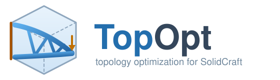
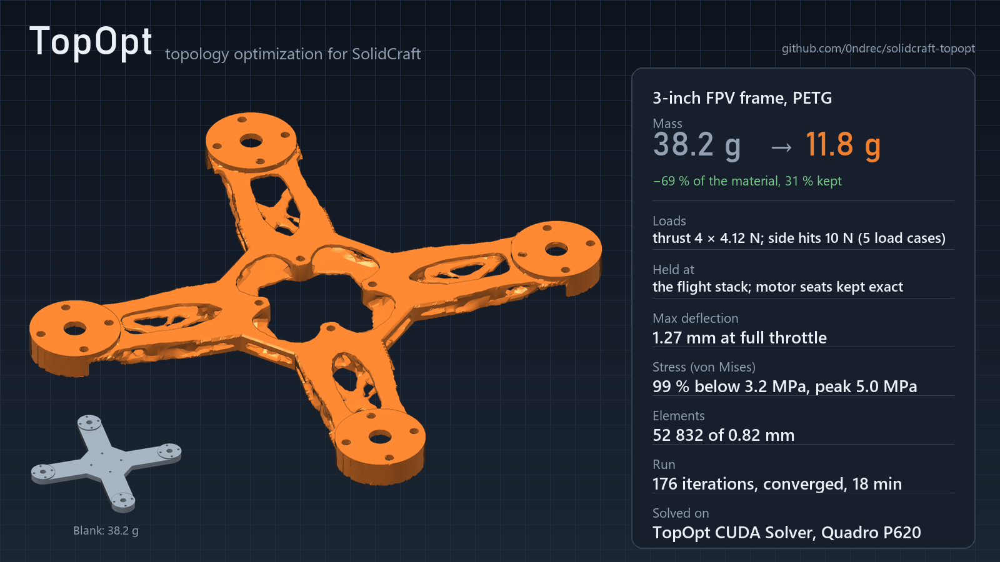

<p align="center">
  
</p>

<p align="center">
  <b>Topology optimization for <a href="https://github.com/tangency-labs/solidcraft">SolidCraft</a>:</b> a CAD plugin, a multi-threaded solver for pipelines, and the Rust crates behind both.<br>
  Results are closed, manifold meshes, checked on every run and ready to become solids.
</p>

<p align="center">
  
</p>

## What it does

Give it a design domain, where the part is held, where it is loaded and how much material it may use. TopOpt finds the stiffest shape (SIMP minimum compliance) and turns it into a watertight triangle mesh that keeps the original mounting faces exact.

- **In SolidCraft:** pick a body, its supports and loads; press Optimize; get a new body. A panel guides you step by step.
- **In a pipeline:** describe a study in JSON (a box, an STL or an inline mesh; supports and loads as boxes, spheres and planes) and run `topopt-solver solve`, or `topopt-cuda-solver solve` to use an NVIDIA GPU. You get PLY/STL, the density field and a JSON summary, with JSON-lines progress and meaningful exit codes.
- **In your Rust code:** `topopt_solver::run()` in memory, with progress callbacks and cancellation; or the core, mesher and study crates on their own.


## Highlights

- **Fast solver:** matrix-free Hex8 finite elements, geometric multigrid-preconditioned CG with element-wise Galerkin coarse levels, density filter, Heaviside projection with β-continuation, optimality criteria. Multi-threaded natively (rayon, lock-free coloured matrix-vector products); single-threaded in the plugin sandbox.
- **Correct, smooth meshes:** marching tetrahedra on the optimizer's filtered field sampled ×2 (round members, not voxels), island and cavity clean-up, bilateral, HC or Taubin smoothing with volume preservation, the original CAD faces, sharp edges and corners kept exact, QEM decimation, and a validator for every guarantee (closed, 2-manifold, oriented, no self-intersections, folds or f32 vertex collisions).
- **NVIDIA GPUs:** TopOpt CUDA Solver runs the same multigrid-CG on the GPU in mixed precision (single-precision V-cycle, double-precision refinement), with the CPU's answer: linear solves 3–4× faster than 6 CPU threads even on an entry-level Quadro P620. No CUDA toolkit needed, only the driver; without a GPU it falls back to the CPU.
- **Checked results:** every run analyses its result once more under each load case and reports the largest deflection (mm) and the von Mises stress (MPa) to compare with the material's strength; it agrees with beam theory within 1.5 %.
- **Optional trimming** of thin dead weight, piece by piece, within a stiffness budget you set.
- **Verified:** the core agrees with an independent Python implementation to 1.45·10⁻⁸; meshes pass trimesh's watertightness checks and SolidCraft's `mesh.convert`.
- **Works around the sandbox:** the plugin hands heavy runs to TopOpt Solver over a small file protocol and gets every CPU core (3–5× faster on a 6-core machine), and solves by itself when the solver is not running.

## Example: a lighter FPV frame

A 3-inch FPV drone frame printed in PETG, from a solid blank: held at the flight stack, pushed by full-throttle thrust on the motor seats (4 × 4.12 N) and by side hits on each arm (10 N). TopOpt CUDA Solver kept 30 % of the material in 18 minutes on an entry-level GPU. The frame went from **38.2 g to 11.8 g**; at full throttle its motors move 1.27 mm and the stress stays under 5 MPa, a safety factor of 4 against PETG printed across layers. The motor seats, kept surfaces, are the CAD model's own faces.

The whole study, with where the loads come from and how the result was checked: [examples/fpv-frame](examples/fpv-frame/README.md).

## Install

- **The plugin:** from the [SolidCraft Workshop](https://workshop.solidcraft.io/plugins) (search for TopOpt), or download `topopt-<version>.zip` from [Releases](https://github.com/0ndrec/solidcraft-topopt/releases) and install it from Preferences › Plugins (then restart SolidCraft). [User guide](docs/plugin.md).
- **TopOpt Solver and TopOpt CUDA Solver** (Windows x64): `topopt-solvers-<version>-windows-x64.zip` from the same release. Unzip it and run `start-topopt-solver.cmd`, or `start-topopt-cuda-solver.cmd` with an NVIDIA GPU, on the folder granted to the plugin as `results`.

## Quick start

Requirements: Rust stable with the `x86_64-pc-windows-gnu` toolchain (or your platform's) and the `wasm32-unknown-unknown` target; Python 3 for the generators; SolidCraft 0.49.1 for the plugin.

```sh
# TopOpt Solver and TopOpt CUDA Solver -> build/solver/
scripts/build-solver.sh

# A first study without SolidCraft
build/solver/topopt-solver example > cantilever.json
build/solver/topopt-solver solve cantilever.json --out out   # out/cantilever.ply, .density.json, .result.json
build/solver/topopt-cuda-solver solve cantilever.json --out out   # the same on an NVIDIA GPU

# The plugin -> build/topopt.zip (then install it from Preferences › Plugins and restart SolidCraft)
python -I scripts/gen_topopt_icons.py && python -I scripts/gen_topopt_manifest.py && scripts/build-plugin.sh topopt

# Tests
cargo +stable-x86_64-pc-windows-gnu test --workspace --release --exclude topopt-plugin
```

More specs: [`examples/`](examples).

## Documentation

| | |
|---|---|
| [Overview](docs/README.md) | Components and how they fit |
| [Plugin user guide](docs/plugin.md) | Installing and using the plugin in SolidCraft |
| [Choosing the settings](docs/settings-guide.md) | What each study and mesh setting changes, measured on one bracket |
| [TopOpt Solver](docs/topopt-solver.md) | CLI, spec format, outputs, progress, exit codes, Rust API, pipeline examples |
| [TopOpt CUDA Solver](docs/topopt-cuda.md) | The solver on an NVIDIA GPU: use, how it works, accuracy, performance, kernels |
| [topopt-core](docs/topopt-core.md) | The optimizer and the multigrid solver |
| [topopt-mesh](docs/topopt-mesh.md) | Density field to a closed mesh |
| [topopt-study](docs/topopt-study.md) | Geometry to problem: voxelization, regions, the solver protocol |
| [Development](docs/development.md) | Build, tests, release, host limits |
| [Design notes](docs/design-notes.md) | Why it is built this way; measurements; roadmap |

## Layout

```
crates/topopt-core/     FE + multigrid-CG + SIMP optimizer
crates/topopt-cuda/     the multigrid-CG on an NVIDIA GPU; kernels/ (Rust for nvptx, checked in as PTX)
crates/topopt-mesh/     density field -> watertight manifold mesh; STL/PLY
crates/topopt-study/    studies, ray voxelization, specs, plugin <-> solver protocol
plugins/topopt-src/     the SolidCraft plugin (WebAssembly component)
plugins/topopt/         the plugin package: generated manifest, icons
tools/topopt-solver/    TopOpt Solver: library + CLI
tools/topopt-cuda-solver/ TopOpt CUDA Solver: the same CLI with the GPU
tools/reference/        Python cross-checks (independent optimizer, trimesh mesh check)
examples/               the FPV frame study (SolidCraft) and example specs (solver)
scripts/                builds, generators, headless SolidCraft tests, mesh renderer
wit/                    SolidCraft's plugin WIT (craft:plugin@0.2.0)
xtask/                  componentize the plugin without wasm-tools
```

## License

Licensed under the [Apache License, Version 2.0](LICENSE). `wit/plugin.wit` is SolidCraft's, licensed MIT OR Apache-2.0 ([wit/README.md](wit/README.md)).
