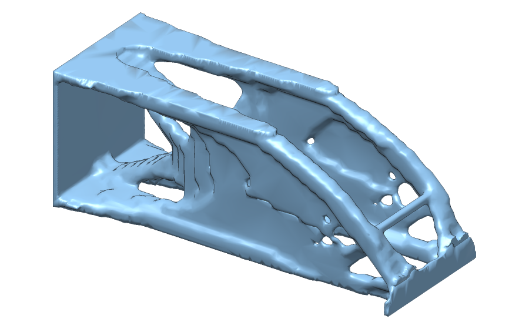
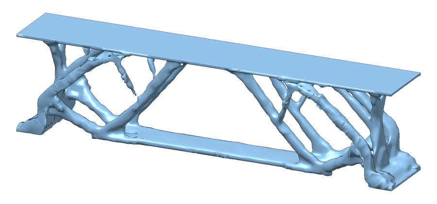
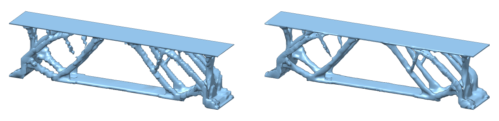
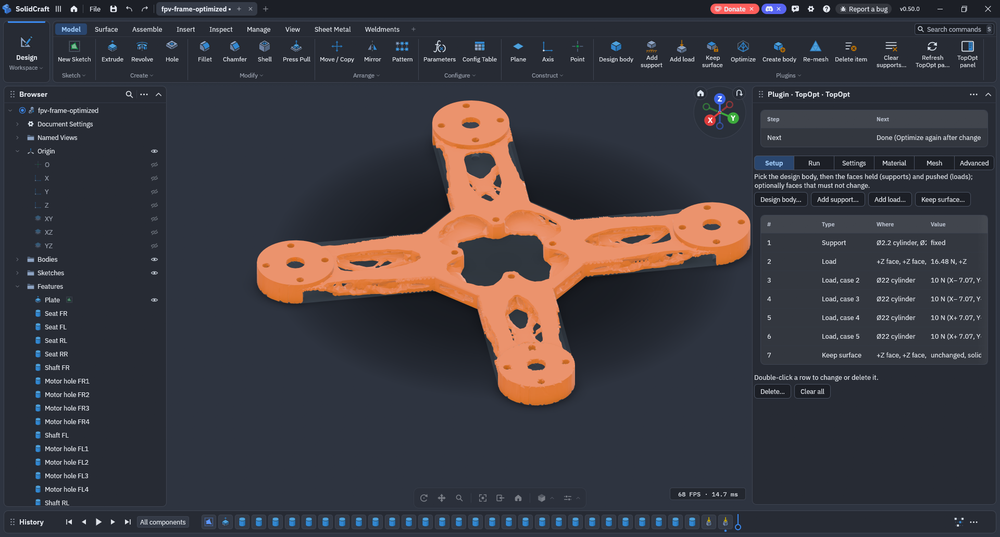
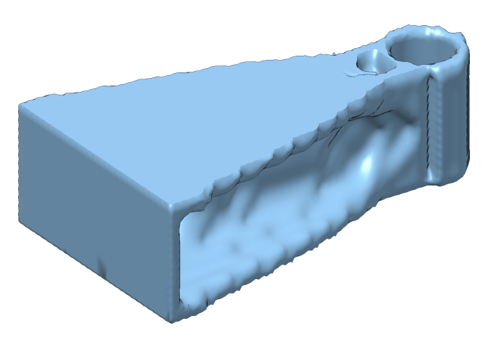

<p align="center">
  
</p>

<p align="center">
  <b>Topology optimization for <a href="https://github.com/tangency-labs/solidcraft">SolidCraft</a>:</b> a CAD plugin, a multi-threaded solver for pipelines, and the Rust crates behind both.<br>
  Results are closed, manifold meshes, checked on every run and ready to become solids.
</p>

<p align="center">
  
  
</p>

## What it does

Give it a design domain, where the part is held, where it is loaded and how much material it may use. TopOpt finds the stiffest shape (SIMP minimum compliance) and turns it into a watertight triangle mesh that keeps the original mounting faces exact.

- **In SolidCraft:** pick a body, its supports and loads; press Optimize; get a new body. A panel guides you step by step.
- **In a pipeline:** describe a study in JSON (a box, an STL or an inline mesh; supports and loads as boxes, spheres and planes) and run `topopt-solver solve`. You get PLY/STL, the density field and a JSON summary, with JSON-lines progress and meaningful exit codes.
- **In your Rust code:** `topopt_solver::run()` in memory, with progress callbacks and cancellation; or the core, mesher and study crates on their own.

<p align="center">
  
  <br><i>Before and after: struts meshed from the voxel densities (left) and from the smooth filtered field, sampled ×2 (right).</i>
</p>



## Highlights

- **Fast solver:** matrix-free Hex8 finite elements, geometric multigrid-preconditioned CG with element-wise Galerkin coarse levels, density filter, Heaviside projection with β-continuation, optimality criteria. Multi-threaded natively (rayon, lock-free coloured matrix-vector products); single-threaded in the plugin sandbox.
- **Correct, smooth meshes:** marching tetrahedra on the optimizer's filtered field sampled ×2 (round members, not voxels), island and cavity clean-up, bilateral, HC or Taubin smoothing with volume preservation, the original CAD faces, sharp edges and corners kept exact, QEM decimation, and a validator for every guarantee (closed, 2-manifold, oriented, no self-intersections, folds or f32 vertex collisions).
- **Optional trimming** of thin dead weight, piece by piece, within a stiffness budget you set.
- **Verified:** the core agrees with an independent Python implementation to 1.45·10⁻⁸; meshes pass trimesh's watertightness checks and SolidCraft's `mesh.convert`.
- **Works around the sandbox:** the plugin hands heavy runs to TopOpt Solver over a small file protocol and gets every CPU core (3–5× faster on a 6-core machine), and solves by itself when the solver is not running.

## Quick start

Requirements: Rust stable with the `x86_64-pc-windows-gnu` toolchain (or your platform's) and the `wasm32-unknown-unknown` target; Python 3 for the generators; SolidCraft 0.49.1 for the plugin.

```sh
# TopOpt Solver -> build/solver/
scripts/build-solver.sh

# A first study without SolidCraft
build/solver/topopt-solver example > cantilever.json
build/solver/topopt-solver solve cantilever.json --out out   # out/cantilever.ply, .density.json, .result.json

# The plugin -> build/topopt.zip (then install it from Preferences › Plugins and restart SolidCraft)
python -I scripts/gen_topopt_icons.py && python -I scripts/gen_topopt_manifest.py && scripts/build-plugin.sh topopt

# Tests
cargo +stable-x86_64-pc-windows-gnu test --workspace --release --exclude topopt-plugin
```

More specs: [`examples/`](examples).

## Documentation

| | |
|---|---|
| [Overview](docs/README.md) | Components and how they fit |
| [Plugin user guide](docs/plugin.md) | Installing and using the plugin in SolidCraft |
| [TopOpt Solver](docs/topopt-solver.md) | CLI, spec format, outputs, progress, exit codes, Rust API, pipeline examples |
| [topopt-core](docs/topopt-core.md) | The optimizer and the multigrid solver |
| [topopt-mesh](docs/topopt-mesh.md) | Density field to a closed mesh |
| [topopt-study](docs/topopt-study.md) | Geometry to problem: voxelization, regions, the solver protocol |
| [Development](docs/development.md) | Build, tests, release, host limits |
| [Design notes](docs/design-notes.md) | Why it is built this way; measurements; roadmap |

## Layout

```
crates/topopt-core/     FE + multigrid-CG + SIMP optimizer
crates/topopt-mesh/     density field -> watertight manifold mesh; STL/PLY
crates/topopt-study/    studies, ray voxelization, specs, plugin <-> solver protocol
plugins/topopt-src/     the SolidCraft plugin (WebAssembly component)
plugins/topopt/         the plugin package: generated manifest, icons
tools/topopt-solver/    TopOpt Solver: library + CLI
tools/reference/        Python cross-checks (independent optimizer, trimesh mesh check)
examples/               example specs
scripts/                builds, generators, headless SolidCraft tests, mesh renderer
wit/                    SolidCraft's plugin WIT (craft:plugin@0.2.0)
xtask/                  componentize the plugin without wasm-tools
```

<p align="center">
  
</p>

## License

Licensed under either of [Apache License, Version 2.0](LICENSE-APACHE) or [MIT license](LICENSE-MIT) at your option. `wit/plugin.wit` is SolidCraft's, under the same terms ([wit/README.md](wit/README.md)).
