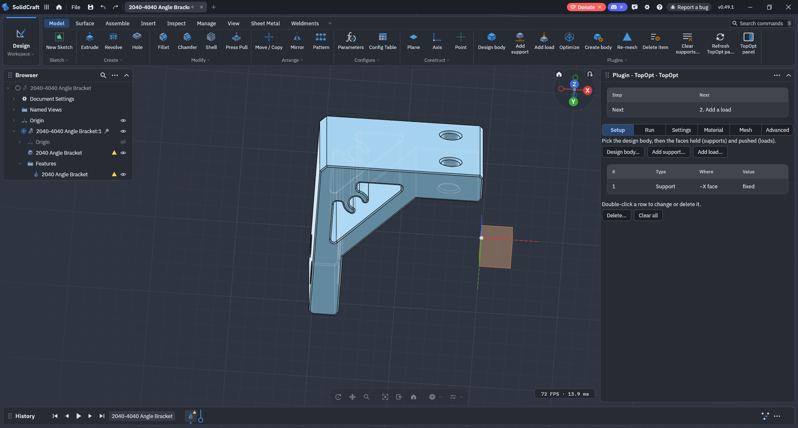

# The TopOpt plugin for SolidCraft — user guide

The TopOpt plugin (v0.6.0, SolidCraft 0.49.1) does **topology optimization** in your model. You say where material may go, where the part is held and where it is pushed; the plugin finds the stiffest shape from the share of material you allow and inserts it into the model as a body.



## Install

1. Build the package `build/topopt.zip` ([development.md](development.md)).
2. Install it from **Preferences › Plugins** in SolidCraft. The app lists the permissions the plugin asks for:
   - model commands (read bodies and faces, `view.pick` rays, body meshes, insert and convert meshes);
   - the `file` command group and a **`results`** folder with read and write access: meshes go there, and TopOpt Solver exchanges jobs through it. Choose a folder, e.g. `<repo>/build/results`;
   - the clock;
   - limits: fuel up to 10 T, 1024 MiB of memory.
3. **Restart SolidCraft.** The app caches the plugin's buttons; until a restart the ribbon may show old ones.

From the command line (as the project's scripts do), installing takes two steps: a `dry_run` returns the `approval`, then the install uses it:

```sh
solidcraft-cli --keep-plugin-approvals exec plugin.install '{"path": "<repo>/build/topopt.zip", "dry_run": true}'

solidcraft-cli --keep-plugin-approvals exec plugin.install '{"path": "<repo>/build/topopt.zip", "approval": "<from dry_run>", "replace": true, "approve": {"command_groups": ["file"], "fuel": 10000000000000, "memory_mib": 1024, "folders": [{"name": "results", "path": "<repo>/build/results", "read": true, "write": true}]}}'
```

After installing, the **Plugins** group of the **Model** tab has 10 buttons with icons; **TopOpt panel** opens the panel (docked right; move it left or down if you like).

## Workflow

The **Next** row at the top of the panel always tells you the next step.

### 1. Design body — **Design body…**

Pick the body material may occupy (a blank, or the part's envelope). The dialog:

| Field | Meaning |
|---|---|
| Design body | The domain body |
| Keep empty | Bodies whose space must stay free: bolt heads, cables, neighbouring parts |
| Material | A preset, or Custom (then set E, ν and density on the Material tab) |
| Keep | How much of the body's volume the result may use, % (default 30) |
| Element size | Element edge, mm; 0 = from the budget |
| Element budget | More elements give finer detail and take longer (40 000: a few minutes without the solver) |
| Thinnest member | Smallest strut or wall, mm; 0 = about three elements |

### 2. Supports — **Add support…**

Pick the faces of the design body that are bolted, clamped or resting on something. Untick **Hold in X/Y/Z** to let a face slide along that axis. Add as many supports as you need.

### 3. Loads — **Add load…**

Pick the faces the force acts on; it is spread evenly over them.
- **Along X, Y, Z**: the total force Fx, Fy, Fz in N (default 1000 N down, −Z).
- **Pushing into the faces**: the force's magnitude, N, into the faces.
- **Load case**: loads with the same number act together; different numbers are separate situations the part must survive.

The table on the **Setup** tab lists the supports and loads. **Double-click** a row to open its dialog and change or delete it. **Delete…** removes an item by number; **Clear all** removes them all.

### 4. Run — **Optimize**

Optimize is a long-running job: progress and Cancel are in the operations panel (bottom right).
- If **TopOpt Solver** is running (below), the plugin voxelizes the body in 1–2 s and hands the job over; the solver uses every core. Press **Refresh** on the **Run** tab to see its progress.
- Without the solver, the job runs inside SolidCraft on one thread, 3–5 times slower.

### 5. Result — **Create body**

Inserts the result as a mesh body and, when "Create body makes a solid" is on (Mesh tab), converts it to a solid. The **Run** tab summarizes the run: outcome, iterations and time, volume share, mass, compliance (lower is stiffer), grid, triangles and genus (through-holes), warnings.

**Re-mesh** makes a new mesh from the saved densities with other Mesh settings (triangles, smoothing, threshold) without optimizing again.

## Panel tabs

| Tab | Content |
|---|---|
| **Setup** | Design body, Add support, Add load; the item table; Delete, Clear all |
| **Run** | Optimize, Create body, Re-mesh, Refresh; study status (where it runs, time estimate); the result |
| **Settings** | Keep %, element size, element budget, thinnest member, max iterations (default 150), time limit (480 s) |
| **Material** | Preset (aluminium 6061 and 7075, structural steel, stainless 316, Ti-6Al-4V, PLA, PETG, ABS, PA12, Custom); E, ν, density |
| **Mesh** | Triangles (up to 50 000), smoothing passes, keep the body's faces exact, remove floating pieces, fill closed cavities, Create body makes a solid |
| **Advanced** | Use TopOpt Solver when it is running; pad thickness under supports and loads; SIMP penalty; final sharpness β; move limit; surface density threshold |

Every change in the panel is one undo step. The study is stored in the design file, and the densities in the plugin's data inside the design (for Re-mesh).

## TopOpt Solver: all CPU cores

The SolidCraft sandbox gives a plugin one thread (about 17 % of a 6-core CPU). TopOpt Solver is a separate program that solves the same jobs on every core.

1. Double-click `build/solver/start-topopt-solver.cmd` (built by `scripts/build-solver.sh`). A "TopOpt Solver" window opens; minimize it.
2. It watches `build/results`, or the folder you pass as its first argument. That folder must be the plugin's `results` folder.
3. The Run tab's **Runs on** row then says "TopOpt Solver, N threads", and Optimize hands its jobs over.
4. Closing the window stops the solver. Pressing Optimize again cancels the solver's previous job.

To keep the solver running but unused, untick "Use TopOpt Solver when it is running" on the **Advanced** tab.

The solver also solves studies without SolidCraft, from the command line and scripts: [topopt-solver.md](topopt-solver.md).

## Tips

- Start with a budget of 20–40 thousand elements and Keep 25–35 %; run the final study finer.
- Give the thinnest part of the body at least 8 elements (otherwise you get a warning and a slow run).
- Put supports and loads on **faces of the design body**, not of neighbouring parts.
- A solid layer always stays under supports and loads (its thickness is on the Advanced tab): these are the mounting surfaces.
- A spongy result: raise Thinnest member or the iterations. Thin struts breaking: use smaller elements.

## Limitations

- The body must be in the root component: mesh and pick coordinates are taken as world coordinates.
- On a coarse grid the result's volume is 2–8 % below the target: keeping the faces exact trims voxelization half-cells.
- Sharp edges of the original body come out slightly stepped.
- The result mesh has at most 50 000 triangles, because the host lets a plugin write at most 1 MiB at a time.
- The first run after installing uses the baseline compiler and is about twice as slow; the compiled code is then cached.
- The solver's progress in the panel updates on Refresh, not by itself, and the panel has no Cancel for a solver job.

## Troubleshooting

| You see | Do |
|---|---|
| Old or broken ribbon buttons | Restart SolidCraft after installing |
| "item N: its faces were not found on the body" | The face is too small for the grid: lower Element size |
| Optimize stops running out of fuel | The study is too big for the sandbox: start TopOpt Solver or lower the budget |
| "Runs on: SolidCraft, 1 core (TopOpt Solver not running)" while the solver runs | Different folders: the solver's folder and the plugin's `results` folder must be the same |
| An empty or broken result | Check that supports and loads are on the same body and Keep is not too small |
| Create body makes no solid | Read the warnings on the Run tab; untick "Create body makes a solid" to get at least the mesh body |
