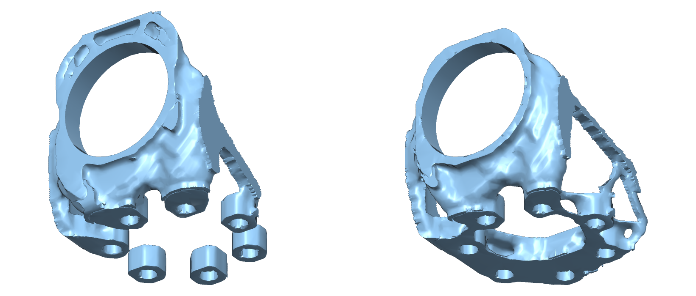
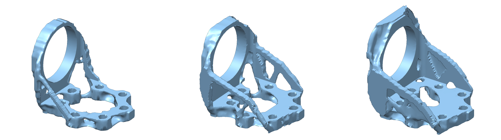
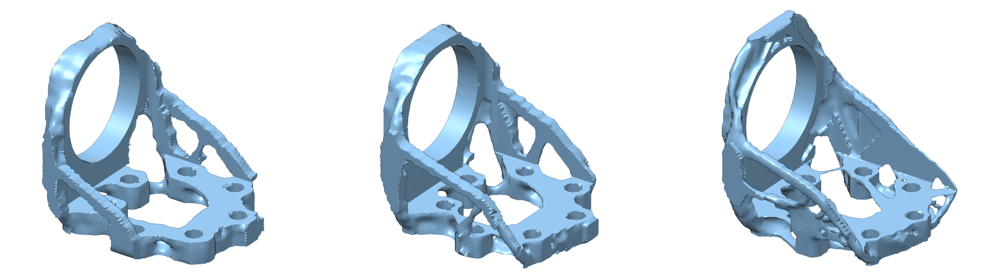
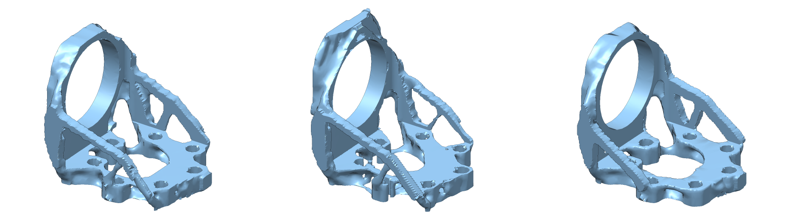
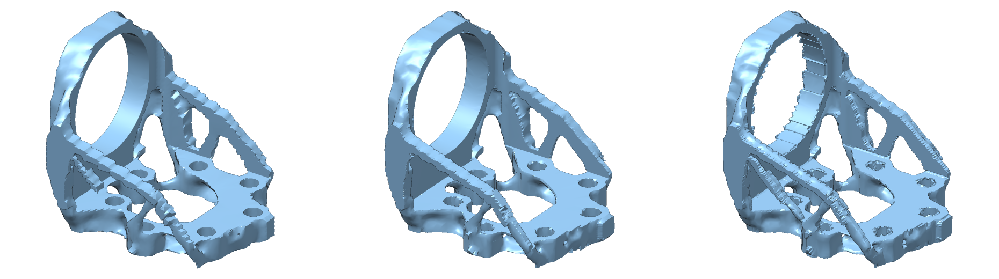

# Choosing the settings — a study on one bracket

Which settings matter, and what each one costs? One part was optimized with seven sets of study settings and then meshed again from the same result with twelve sets of Mesh settings. These tables show what changes. Use them to pick a starting point and to find which setting to change when a result is not what you need.

## The part

An angle bracket, 32 × 30 × 32 mm, in PETG (E = 2100 MPa). The blank is 7158 mm³, which is **9.09 g**.

- **Supports:** the faces of its seven bolt holes, fixed.
- **Loads:** on the bore, in two load cases: 300 N down, and 150 N sideways.
- **Keep surface:** the bore.

The baseline settings were:

- Keep 30 %, element budget 100 000, default pad, no thinnest member;
- "Join every support to the part" on (the default);
- up to 200 iterations; every run converged after 167 or 168;
- default Mesh settings.

Each run was solved by TopOpt CUDA Solver on a Quadro P620, and timed there. The deflection and stress come from the result check on the Run tab (see [plugin.md](plugin.md#5-result--create-body)). **Stress p99** is the stress that 99 % of the material stays below. Compare it with your material's strength divided by a safety factor. For a 3D print, use the strength across layers.

## Every bolt hole joined

Left to itself, the optimizer leads the load into the bolt holes nearest to the bore and leaves the others without material. Here it used only 3 to 5 of the 7 holes, depending on Keep, and the unused holes stayed as rings floating beside the part.

With "Join every support to the part", each hole left out is made to carry the load alone in a helper load case, and the study runs again ([how it works](topopt-study.md#every-support-joined-joints)). In every run below, 2 to 4 holes needed this, and all seven ended up joined.

The price, on the baseline:

- **Time:** 645 s instead of 146 s.
- **Stiffness:** the compliance is 36 % higher (164 against 120) than that of the part held by only four holes. With the same material, the plate joining the far holes comes out of the main load path.

  

*Without joining (left): four holes used, three rings floating. With it (right): all seven in one part.*

## Study settings

  

*Keep 20 %, 30 % (baseline) and 45 %.*

  

*Element budget 40 000, 100 000 (baseline) and 250 000.*

  

*Baseline, pad 0.6 mm, and thinnest member 3 mm.*

Each row changes one setting from the baseline. The times include the second run that joins the holes.

| Changed | Elements in the body (size) | Time | Mass (of the blank) | Deflection, load case 1 / 2 | Stress p99, load case 1 / 2 | Peak stress | Compliance | Holes joined in the second run | Through-holes |
|---|---|---|---|---|---|---|---|---|---|
| Keep 20 % | 18 240 (0.74 mm) | 665 s | 1.99 g (22 %) | 3.22 / 2.75 mm | 36.1 / 41.4 MPa | 58 MPa | 339 | 4 of 7 | 25 |
| **Baseline** (Keep 30 %) | 18 240 (0.74 mm) | 645 s | 2.91 g (32 %) | 1.17 / 1.16 mm | 21.1 / 23.0 MPa | 38 MPa | 164 | 3 of 7 | 22 |
| Keep 45 % | 18 240 (0.74 mm) | 384 s | 4.33 g (48 %) | 0.49 / 0.60 mm | 13.7 / 13.6 MPa | 25 MPa | 91 | 2 of 7 | 24 |
| Element budget 40 000 | 7 098 (1.00 mm) | 189 s | 3.17 g (35 %) | 1.59 / 1.37 mm | 22.8 / 23.6 MPa | 39 MPa | 199 | 3 of 7 | 19 |
| Element budget 250 000 | 53 252 (0.51 mm) | 1938 s | 2.79 g (31 %) | 0.92 / 0.97 mm | 19.8 / 21.5 MPa | 39 MPa | 146 | 2 of 7 | 40 |
| Pad 0.6 mm (default 1.1 mm) | 18 240 (0.74 mm) | 993 s | 2.79 g (31 %) | 0.79 / 0.88 mm | 18.6 / 19.4 MPa | 34 MPa | 134 | 2 of 7 | 37 |
| Thinnest member 3 mm | 18 240 (0.74 mm) | 556 s | 2.96 g (33 %) | 1.23 / 1.15 mm | 21.8 / 23.0 MPa | 41 MPa | 170 | 3 of 7 | 16 |

The through-holes include the seven bolt holes and the bore.

What the numbers say:

- **Keep is the main lever.**
  - From 30 % down to 20 %, the part loses 0.9 g but bends 2.5 times as much, and its stress rises from 23 to 41 MPa.
  - Going to 45 % halves the deflection and lowers the stress to 14 MPa.
  - Choose Keep by the stress your material can take; Keep 20 % saves weight only on paper.
- **The element budget counts the whole bounding box**, not the body. Here a budget of 100 000 gave a 44 × 44 × 44 grid, of which only 18 240 elements lie in the bracket.
  - 40 000 is a good draft: 3.4 times faster and the same layout, but 36 % more flexible, because its struts are coarser.
  - 250 000 is 3 times slower; it deflects 20 % less than 100 000 (compliance 11 % lower), with finer, more numerous struts.
  - Aim for roughly 15 000–20 000 elements inside the body. Give thin-walled parts a larger budget.
- **Pad** is the solid layer under supports and loads (Advanced tab). A thinner pad takes less of the Keep budget, so the optimizer has more material to place. Here it was the best single change: a third less deflection and 18 % lower compliance, with 0.1 g less mass. The costs are thinner walls around the bolt holes and a longer run.
- **Thinnest member** of 3 mm gives fewer, thicker struts: 16 through-holes instead of 22. It is easier to print, and only 4 % more flexible.

## Mesh settings

All rows are made by **Re-mesh** from the baseline result, so the part is the same. Only its surface changes. Each row changes one setting from the defaults:

- Bilateral smoother, 20 smoothing passes;
- Finer surface 2;
- sharp edges kept, joints rounded, volume kept;
- 30 000 triangles.

  

*Finer surface 1, 2 (default) and 3.*

  

*10 000, 30 000 (default) and 50 000 triangles.*

| Changed | Time | Triangles | Volume | Surface bend, mean / p95 | Worst triangle | Bore (kept) | Solid in SolidCraft |
|---|---|---|---|---|---|---|---|
| **Defaults** | 38 s | 29 180 | — | 10.4° / 31.8° | 0.005 | exact | yes |
| Smoothing passes 5 | 11 s | 27 988 | 0.0 % | 11.0° / 34.0° | 0.001 | exact | yes |
| Smoothing passes 40 | 69 s | 28 662 | 0.0 % | 10.6° / 31.7° | 0.003 | exact | yes |
| Smoother Taubin | 98 s | 29 998 | −0.1 % | 13.1° / 37.2° | 0.003 | 0.32 mm off | yes |
| Smoother HC | 19 s | 28 766 | 0.0 % | 11.7° / 34.5° | 0.027 | exact | yes |
| Finer surface 1 | 5 s | 29 428 | −1.8 % | 7.8° / 24.0° | 0.039 | exact | yes |
| Finer surface 3 | 440 s | 45 000 | +1.5 % | 11.5° / 37.4° | 0.014 | 0.33 mm off | yes |
| Sharp edges off | 15 s | 28 754 | +0.1 % | 10.3° / 31.1° | 0.001 | exact | yes |
| Round the joints off | 25 s | 28 798 | −5.4 % | 10.9° / 32.2° | 0.003 | exact | yes |
| Keep the volume off | 43 s | 28 466 | +0.8 % | 10.6° / 32.9° | 0.009 | exact | yes |
| Triangles 10 000 | 27 s | 9 486 | +0.1 % | 12.1° / 37.2° | < 0.001 | exact | yes |
| Triangles 50 000 | 46 s | 48 384 | 0.0 % | 8.9° / 27.4° | 0.003 | exact | yes |

How to read the columns:

- **Time:** the Re-mesh time. Two runs went side by side on the CPU, so compare the times with each other, not with your machine.
- **Volume:** compared with the defaults.
- **Surface bend:** the angle between neighbouring triangles. Only angles below 45° are counted, so edges are left out. Lower means a smoother surface; compare rows with similar triangle counts.
- **Worst triangle:** the shape of the worst triangle, from 1 (equilateral) down to 0 (a sliver).
- **Bore (kept):** how far the kept bore is from the CAD face. "Exact" means the CAD model's own triangles were stitched in.
- **Solid in SolidCraft:** whether `mesh.convert` (Create body with "Create body makes a solid") turned the mesh into a solid.

What the numbers say:

- **The defaults are a good start.** Every row converted to a solid.
  - On an earlier result of this bracket, SolidCraft could not sew the default mesh (`sew: unsupported edge contact`), while HC and 40 smoothing passes converted.
  - So when Create body leaves a mesh body and the warning names `sew`, Re-mesh with **HC** or **40 smoothing passes** and Create body again.
- **When the bore (a kept surface) is not exact,** the Run tab warns that a kept surface "could not take the CAD model's own triangles". Here this happened with Taubin and Finer surface 3: the bore was ragged, about 0.33 mm off. With kept surfaces, stay with the bilateral smoother or HC, and Finer surface 2 or less.
- **Smoothing passes:**
  - 5 passes is the fastest full-quality mesh here, at 11 s, slightly rougher than 20.
  - 40 passes is no smoother than 20 on this part.
- **Finer surface:**
  - 1 is eight times faster and the smoothest surface, but 1.8 % lighter and less detailed. Use it for quick looks.
  - 3 took over 7 minutes, needed 45 000 triangles and lost the bore. Avoid it.
- **Triangles:**
  - 10 000 keeps the shape and volume, and is enough for printing and lighter to handle in CAD, though it leaves a sliver or two.
  - 50 000 gives the smoothest surface.
- **Round the joints** adds 5 % material where struts meet the pads. Leave it on: those joints carry the load.
- **Keep the volume** holds the volume through smoothing. Without it, this mesh grew by 0.8 %.
- **Sharp edges:** turning it off changed nothing measurable on this part.

## Quick choices

| You want | Set |
|---|---|
| A first look in a few minutes | Element budget 40 000; Finer surface 1 |
| The final part | A budget that gives about 15 000–20 000 elements in the body (here 100 000); default Mesh settings |
| Lighter | Lower Keep, then check stress p99 against strength / safety factor |
| Stiffer, lower stress | Higher Keep; or a thinner pad (Advanced) |
| Every bolt hole in the part | Keep "Join every support to the part" on (Settings); it takes longer |
| Easier to print | Thinnest member 2–3 × the nozzle width or more |
| A solid when Create body gives only a mesh | Re-mesh with the HC smoother or 40 smoothing passes |
| A kept surface exact again | Re-mesh with the bilateral smoother (default) or HC, Finer surface 2 or less |
| A lighter file | Triangles 10 000–20 000 |
| The smoothest surface | Triangles 50 000 |

How the study was run: the job was written by the plugin and solved with `topopt-cuda-solver solve`. Every mesh came from `topopt-solver remesh` with the changed Mesh setting. Each mesh was measured by a script (triangle shapes, bend angles, the bore's distance from the CAD face) and converted with `file.insert_mesh` and `mesh.convert` in `solidcraft-cli`.
