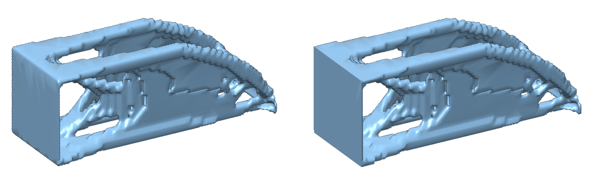
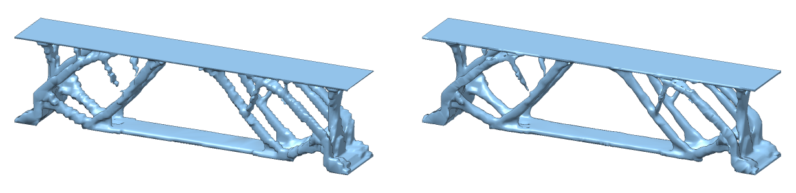

# topopt-mesh — from a density field to a closed mesh

`crates/topopt-mesh` turns a density field (values 0…1 on a regular lattice) into a triangle mesh that is guaranteed **closed, 2-manifold, outward-oriented and free of self-intersections**: SolidCraft accepts it as a closed mesh body and converts it to a solid; trimesh, slicers and Blender see it as watertight. Given the original part's surface, it also keeps that surface's faces, **sharp edges and corners exact**.

The crate knows nothing about optimization: it needs only the field, so it can surface any scalar field (an SDF, another optimizer's result, a CT scan).



*The same densities meshed without (left) and with (right) sharp-edge pinning: the clamp block's edges and corners are exact on the right.*

## The pipeline: `extract`

```rust
pub fn extract(field: Field, anchors: Option<&[bool]>, surface: Option<&Projector>, opts: &Options)
    -> Result<(Mesh, Report), String>
```

1. **Field** (`field`): optional blur; the border zeroed so the surface closes; values too close to `iso` moved off it by `nudge`; then **component clean-up** with the exact connectivity of the contour (14 neighbours, matching the tetrahedral split): islands without an anchor (`anchors`, usually the pads under supports and loads; without anchors, all but the largest) are removed and closed cavities filled.
2. **Contour** (`mt`): marching tetrahedra on the Freudenthal split (6 tetrahedra per cube, consistent diagonals between neighbours). Inside a tetrahedron linear interpolation gives a flat triangle or a convex quad, so the result is watertight, manifold and self-intersection-free **by construction**, without the ambiguous cases of marching cubes. One vertex per edge (hashed by its two samples); orientation from a table built from exact corner coordinates.
3. **Pinning** to the original surface (`surface`, when given):
   - **creases**: the contour rounds or chamfers the sharp edges of the part (on two of a box's four parallel edges the split's diagonals cut straight across them). Every mesh edge that crosses the bisector plane of a sharp edge, near it and with both ends on the surface, is **split at the crease** (`insert_crease_vertices`). The new vertices lie exactly on the sharp edge and slide along it during smoothing;
   - **corners**: the nearest vertex to each corner of the surface is fixed onto it;
   - **faces**: vertices within `pin_band` of the surface are projected onto it, when the vertex *is* that face of the material — its outward normal (from a freely smoothed copy) agrees with the face's outward normal (cos > 0.6) — and its direction to the surface agrees with that normal. The first test matters for thin plates lying along a face: their inner side points the other way, and pinning it too flattened the plate to nothing (a bridge deck one element thick lost 31 % of the part's volume that way). The surface's outward direction is found from the sign of its enclosed volume, so an inside-out STL works too.
4. **Smoothing** (`smooth`), the pins re-applied after every pass: `Smoother::Taubin` (λ|μ), `Smoother::Hc` (HC Laplacian) or `Smoother::Bilateral` (Taubin for the staircase, then bilateral normal filtering). With `preserve_volume`, the free vertices are then offset along their normals until the volume is back to what it was before smoothing (with the pins applied). Then **crease flips** (`flip_to_creases`) turn any triangle pair that still straddles a crease diagonally into one whose shared edge lies on it. If the surface crosses itself or degenerates, the offending triangles' vertices are unpinned and smoothing is redone; after a few rounds the iteration count is halved. If keeping the sharp edges cannot be made to work at all, the whole mesh is made again without them (`Report::sharp_edges` = false).
5. **Decimation** (`decimate`): quadric-error edge collapses (QEM) to the triangle budget, guarded by the link condition (manifoldness), valence ≥ 3, normal flips (> 60°), triangle quality and the allowed surface error. Pins are ranked: face vertices move only onto other pinned vertices, crease vertices merge only with each other along the crease, corners never move. A result that crosses itself is decimated again with the crossing neighbourhoods locked before the budget is raised. Decimation is deterministic: the same input gives the same mesh.
6. **Validation** (`Mesh::validate`): every guarantee is checked, not assumed; the report is `Report::mesh`. That includes **folds**: two neighbouring triangles folded flat onto each other (normals more than 179.2° apart). A fold is no crossing the intersection test sees, but CAD kernels refuse it (SolidCraft: "a planar group's boundary does not enclose it"); smoothing treats folds like crossings and frees their vertices.

```rust
use topopt_mesh::{Field, Options, Projector, Smoother, extract};

// Samples at the optimizer's cell centres, with a ring of zeros around
let field = Field::from_cells([nx, ny, nz], h, grid_origin, &densities, 1);
let anchors = field.cell_mask([nx, ny, nz], 1, &pads);            // anchor cells
let surface = Projector::new(&body_positions, &body_triangles)?;  // the original surface (optional)
let opts = Options { smoother: Smoother::Bilateral, ..Default::default() };
let (mesh, report) = extract(field, Some(&anchors), Some(&surface), &opts)?;
assert!(report.mesh.ok());
std::fs::write("part.stl", mesh.to_stl("topopt"))?;
```

## Finer fields: `upsample_cells`

`upsample_cells(dims, cells, k)` resamples a cell field `k` times finer along each axis (cell-centred) by separable cubic (Catmull-Rom) interpolation, clamped to 0…1; `upsample_mask` does the same for per-cell flags (each fine cell takes its coarse cell's flag). Contouring the finer field gives round members where the coarse one gives faceted ones: between two samples the surface follows a cubic instead of a straight line. 

*A bridge's struts meshed from the projected densities with Taubin smoothing (left, the previous default) and from the filtered densities sampled ×2 with bilateral smoothing (right, the default now).*

`topopt-study` meshes the optimizer's *filtered* densities upsampled ×2 by default ([topopt-study.md](topopt-study.md)); on a bridge, strut cross-sections fit an ellipse to 0.984 instead of 0.956 and the mean angle between neighbouring triangles fell from 15.7° to 10.4° at the same triangle count.

## Smoothers

| `Smoother` | Method | Use it for |
|---|---|---|
| `Taubin` (default) | λ|μ umbrella smoothing (Taubin 1995): alternate shrinking and inflating steps remove the voxel staircase with little shrinkage | Fast and robust; the baseline |
| `Hc` | HC Laplacian (Vollmer, Mencl & Müller 1999): each Laplacian step is pushed back towards the previous positions (α towards the original), mixed with the neighbours' push-backs | No drift and little shrinkage by construction |
| `Bilateral` | Half the iterations Taubin (the staircase), half bilateral normal filtering (Zheng, Fu, Au & Tai 2011): triangle normals are averaged with weights falling off with distance (`bilateral_sigma`) and with the difference of normals (`bilateral_normal_sigma`), so normals on two sides of a crease do not mix; the vertices then move to fit the filtered normals (Sun et al. 2007), followed by a tangential relaxation that spreads them evenly without changing the shape | The most accurate surface; keeps creases of the result itself (where struts meet), not only of the original surface. The default of `topopt-study` (this crate's `Options` default stays `Taubin`) |

The vertex-based bilateral filter (Fleishman, Drori & Cohen-Or 2003) was tried first: on the irregular triangles of marching tetrahedra it pulled the two walls of thin members together and crossed the surface in hundreds of places, so the normal-filtering form is used instead; each vertex there only moves towards the planes of its own triangles.

**Volume preservation** (`preserve_volume`, on by default) is the "rescaling" step: after smoothing, the free vertices are offset along their normals by a common amount, found with Newton steps on the exact derivative of the volume, until the volume equals the volume before smoothing. It works for any smoother. The offset is limited to `0.25 h ×` the share of free vertices, so a surface pinned almost everywhere does not get bumps in its few free spots. It preserves the volume *of the contour*: the contour of a smooth density at iso 0.5 is itself a little smaller than the true shape (−1.8 % on a sphere of radius 6.3 cells, −5 % on a thin torus), and smoothing cannot know that.

## Measurements

`cargo run --release -p topopt-mesh --example smoothing_compare` (no decimation):

**A solid box 20×12×8 cells with its own surface for pinning** — distance from the true edges and corners to the result, in cells:

| | edge mean | edge max | corner max | volume |
|---|---|---|---|---|
| Taubin, sharp edges off | 0.249 | 0.493 | 0.493 | −0.63 % |
| HC, sharp edges off | 0.181 | 0.346 | 0.346 | −0.38 % |
| Bilateral, sharp edges off | 0.187 | 0.439 | 0.439 | −0.52 % |
| **any smoother, sharp edges on** | **0.000** | **0.000** | **0.000** | **0.00 %** |

**Free shapes (no pinning)** — volume error against the exact solid, and RMS distance to the true surface in cells:

| | sphere r 6.3 | | torus 7 / 2.6 | |
|---|---|---|---|---|
| | volume | RMS | volume | RMS |
| contour, unsmoothed | −1.80 % | | −5.13 % | |
| Taubin | −1.27 % | 0.063 | −4.58 % | 0.077 |
| Taubin + volume | −1.80 % | 0.066 | −5.13 % | 0.081 |
| HC + volume | −1.80 % | 0.055 | −5.13 % | 0.076 |
| **Bilateral + volume** | −1.80 % | **0.048** | −5.13 % | **0.074** |

**A real result** (the 160×60×60 mm cantilever of `examples/`, 59 584 elements, h = 2.1 mm, 30 000 triangles): the distance from the clamp block's edges to the mesh went from 0.66 mm on average (1.0 mm worst) to 0.00 mm along all of them; a whole `topopt-solver remesh` (voxelization included) takes 1.7 s with Taubin, 1.3 s with HC and 3.7 s with Bilateral.

## `Options`

| Field | Default | Meaning |
|---|---|---|
| `iso` | 0.5 | Surface threshold |
| `nudge` | 0.02 | Values closer than this to `iso` are moved off it; also the smallest edge fraction of a contour vertex. Smaller values put vertices closer than f32 resolution in STL (≈ 8 µm at 100 mm) and CAD welds them |
| `blur_passes` | 0 | Blur before contouring. Off: on thin convex members it moves the surface inwards (a torus loses 7 % of its volume, against 1.8 % without) |
| `remove_islands` | true | Remove components without an anchor |
| `fill_cavities` | true | Fill closed cavities |
| `smoother` | `Taubin` | `Taubin`, `Hc` or `Bilateral` |
| `smooth_iterations` | 10 | Smoothing iterations |
| `lambda`, `mu` | 0.5, −0.53 | Taubin coefficients |
| `hc_alpha`, `hc_beta` | 0.0, 0.6 | HC: pull towards the original and towards the previous positions |
| `bilateral_sigma`, `bilateral_normal_sigma` | 1.0, 0.35 | Bilateral: distance scale in sample spacings; normal-difference scale (normals more than ~30° apart barely mix) |
| `preserve_volume` | true | Restore the volume smoothing took |
| `pin_band` | 1.0 | Width of the pinning band at the original surface, in sample spacings |
| `sharp_edges` | true | Keep the original surface's sharp edges and corners (needs a `surface`) |
| `target_triangles` | `Some(40 000)` | Triangle budget (`None`: no decimation). A target, not a cap: crease vertices are kept, so very small budgets end a little above it |
| `max_decimation_error` | 0.25 | Largest RMS surface change of decimation, in sample spacings |
| `check_self_intersections` | true | Look for self-intersections after smoothing and in `validate` |

## `Report`

`cleanup` (components and samples removed or filled), `contour_triangles`, `contour_volume`, `pinned_volume` (with the pins applied, the target of volume preservation), `smoothed_volume`, `pinned_vertices`, `edge_vertices`, `corner_vertices`, `sharp_edges` (kept, or dropped by the fallback), `crease_vertices` (inserted), `crease_flips`, `smooth_iterations` (smoothing iterations kept), `decimated_from`, `collapses`, `mesh: MeshReport`.

## `Projector`: the original surface

`Projector::new(positions, triangles)` builds closest-point queries on the part's surface and finds its **sharp edges** (dihedral angle above 30°, or boundary edges) and **corners** (where one, or three or more, sharp edges meet, or two meet at a sharp turn). `Projector::with_feature_angle(…, degrees)` sets the angle (0 disables features). Vertices of a CAD tessellation that coincide are welded first.

| Method | Returns |
|---|---|
| `project(p)` | Closest point on the surface and its distance |
| `project_with_normal(p)` | …and the normal of the triangle it lies on |
| `nearest_edge(p)` | Closest point on a sharp edge, its distance, the edge's direction and its two faces' normals |
| `nearest_corner(p)`, `corners()` | Closest corner; all corners |
| `feature_segments()` | Number of sharp edge segments |

## `Mesh` and `MeshReport`

```rust
pub struct Mesh { pub positions: Vec<[f64; 3]>, pub triangles: Vec<[u32; 3]> }
```

| Method | Effect |
|---|---|
| `validate(self_intersections) -> MeshReport` | Full check. `ok()` holds when there are triangles; no boundary, non-manifold or misoriented edges; no pinch vertices, degenerate triangles, self-intersections, or vertices that coincide once rounded to f32; and the volume is positive |
| `volume()`, `area()`, `mean_edge()` | Signed volume (positive with outward normals), area, mean edge length |
| `components()` | Connected components by shared edges |
| `compact()` | Drop unused vertices |
| `face_normal(t)` | A triangle's normal |
| `to_stl(header)` | Binary STL |
| `to_ply(comment)` | Binary little-endian PLY (indexed, about half the size of STL) |

`MeshReport`: `vertices`, `triangles`, `edges`, `boundary_edges`, `nonmanifold_edges`, `misoriented_edges`, `nonmanifold_vertices`, `unused_vertices`, `degenerate_triangles`, `components`, `euler`, `genus` (through-holes), `volume`, `area`, `self_intersections` (`None` when not checked), `f32_collisions` (distinct vertices equal in f32, which an STL reader would weld), `folds` (triangle pairs folded flat onto each other).

## Reading (`io`)

- `read_stl(bytes, scale)`: binary or ASCII STL. Corners that are equal bit for bit (f32) are welded into one vertex, so a closed STL gives a closed indexed mesh; triangles that collapse in welding are dropped. `scale` multiplies coordinates (1000 for a file in metres).
- `read_ply(bytes)`: the binary PLY that `to_ply` writes; other PLY layouts are refused.

## Other modules

| Module | Public items |
|---|---|
| `field` | `Field { n, origin, h, values }`: `from_cells`, `cell_mask`, `blur`, `nudge`, `zero_border`, `components`; `clean_components`, `upsample_cells`, `upsample_mask` |
| `mt` | `marching_tetrahedra(&Field, iso) -> Mesh` |
| `smooth` | `taubin`, `hc_laplacian`, `bilateral` (each with a per-vertex `constrain` hook), `restore_volume`, `insert_crease_vertices`, `flip_to_creases`, `Projector`, `Smoother` |
| `decimate` | `decimate(mesh, pinned, &DecimateOptions)`, `decimate_ranked(mesh, rank, …)` (ranked pins, vertex ids kept), `LOCKED`; options `target_triangles`, `max_error`, `max_normal_turn_deg` (60°), `min_quality` (0.15) |

## Verification

| Test | Shows |
|---|---|
| Sphere from an SDF | Closed, manifold, genus 0, volume within 3 % of 4/3 πr³ |
| Torus, whole pipeline | Genus 1, one component, volume −1.8 % |
| 60 random fields, 4³…10³, raw contour and whole pipeline, all three smoothers | Always passes `validate`, self-intersection check included; exactly one component after clean-up |
| Pinned vertices | Lie on the original surface (error < 0.05 h) |
| Sharp edges and corners | A box's 4 edges and 8 corners exact (rounded by up to 0.49 h without), volume exact, decimates to budget |
| Smoothers | Volume kept by all three, no back-off, identical output on a second run |
| Feature detection | A cube has 12 sharp edges and 8 corners; projections onto them |
| Volume restoration | Reaches a target volume to 10⁻⁶ |
| Component clean-up | Islands removed, cavities filled |
| STL and PLY round trips | Welding, volume kept, ASCII and scale |

End to end as well: trimesh (`tools/reference/check_stl.py`: watertight, consistent winding, volume) and SolidCraft (`file.insert_mesh` → `closed: true` → `mesh.convert` to a solid; a 30 000-triangle cantilever converted in 5.1 s with its volume unchanged to 1e-10).

```sh
cargo +stable-x86_64-pc-windows-gnu test --release -p topopt-mesh

# Smoothers and sharp edges on shapes with known answers
cargo +stable-x86_64-pc-windows-gnu run --release -p topopt-mesh --example smoothing_compare

# Optimize a cantilever and write an STL: OUT.stl [NX NY NZ] [H_mm] [TRIANGLES]
cargo +stable-x86_64-pc-windows-gnu run --release -p topopt-mesh --example cantilever_mesh -- cantilever.stl 48 24 24 2 30000
```

## Limitations

- Sharp edges are kept where the **result touches the original surface's creases**; creases the optimizer creates inside the domain (where struts meet) are only as sharp as the smoother keeps them (`Bilateral` keeps them best).
- Curved creases (a hole's rim) are followed through their tessellation: a coarse `model.mesh` gives a polygonal rim.
- Volume preservation keeps the contour's volume, which is slightly below the true volume of a smooth density (see above).
- Surface detail is bounded by the field spacing: a member one or two samples thick comes out lumpy or breaks, which is why the optimizer bounds member size from below with its filter (`min_member`).
- `mesh.convert` in SolidCraft makes one planar face per triangle, so keep budgets around 20–40k triangles.
