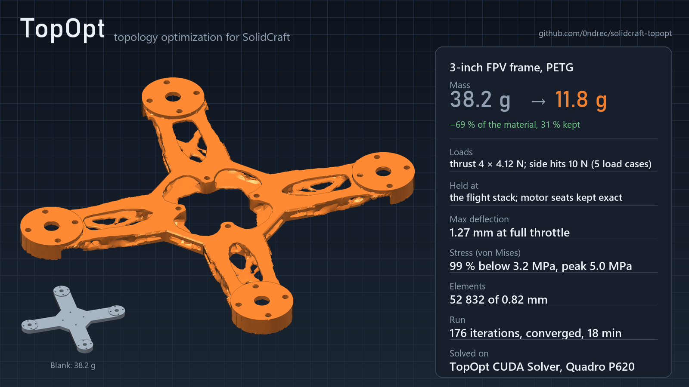

# Example studies

**In SolidCraft, step by step:** [a lighter 3-inch FPV frame in PETG](fpv-frame/README.md): a solid blank, the loads of flight worked out, the study in the TopOpt panel, the result checked for deflection and stress. 69 % lighter, safety factor 4 at the peak.

<p align="center"></p>

**For `topopt-solver`:**

Specs for `topopt-solver` ([format](../docs/topopt-solver.md#4-the-spec-format)). Solve one with:

```sh
topopt-solver check examples/cantilever.json      # the grid and boundary conditions, in a second
topopt-solver solve examples/cantilever.json --out examples/out
```

| Spec | Study | Result |
|---|---|---|
| [cantilever.json](cantilever.json) | A 160×60×60 mm aluminium block clamped at x = 0; 1000 N down along the free bottom edge; keep 15 % | 59 584 elements, converged in 169 iterations, ≈ 220 s on 3 threads; 14.6 % of the volume, 227 g |
| [bridge.json](bridge.json) | A 240×40×60 mm steel span on two bottom supports (one free to slide along X), 5000 N spread over the deck; keep 12 % | 70 800 elements, 200 iterations, ≈ 330 s on 3 threads; 11.2 % of the volume, 507 g |

`topopt-solver example` prints a smaller cantilever with every field at its default: a starting point for your own specs.
