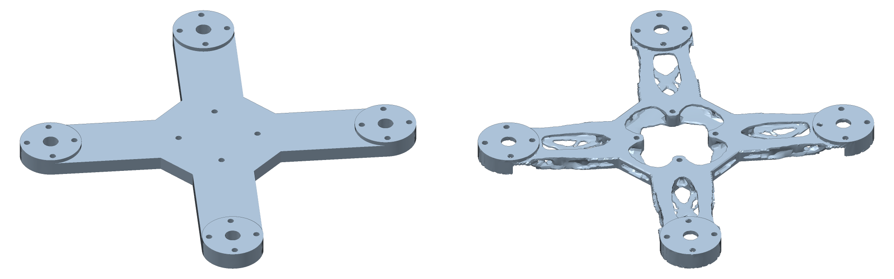
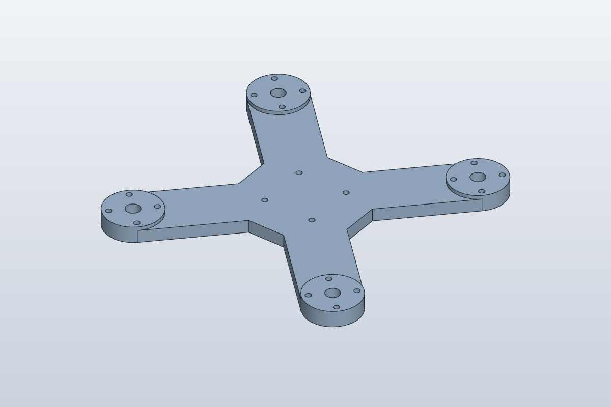
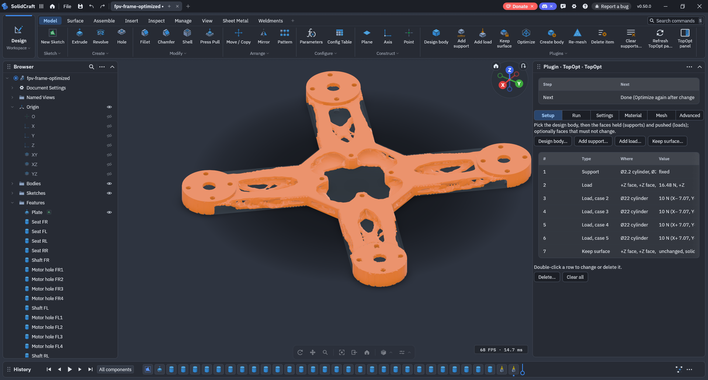
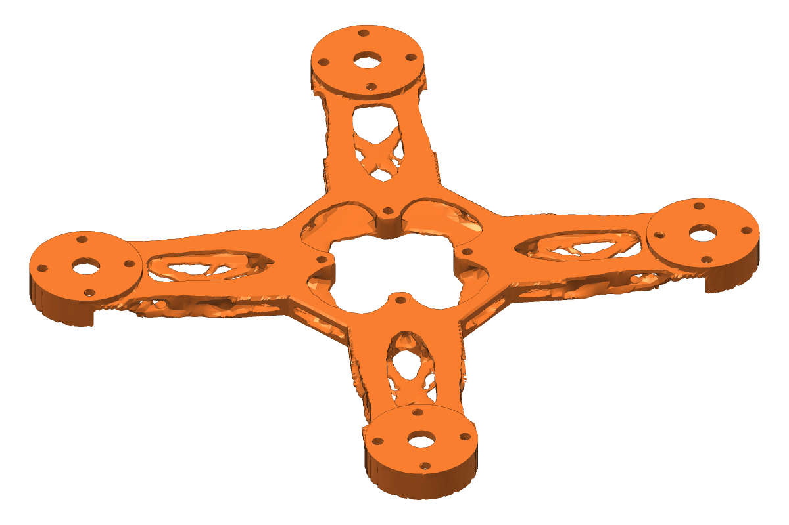
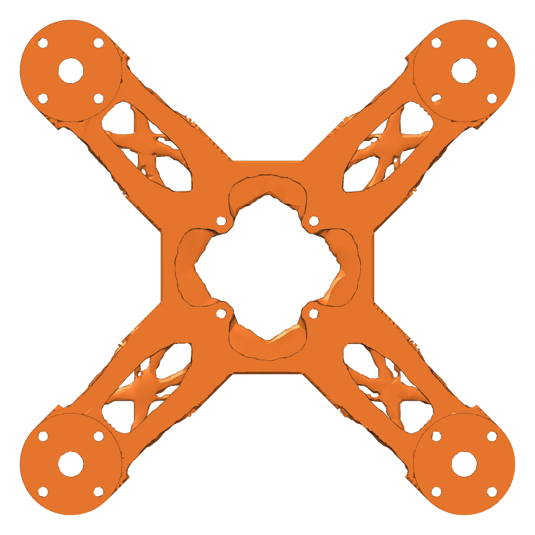
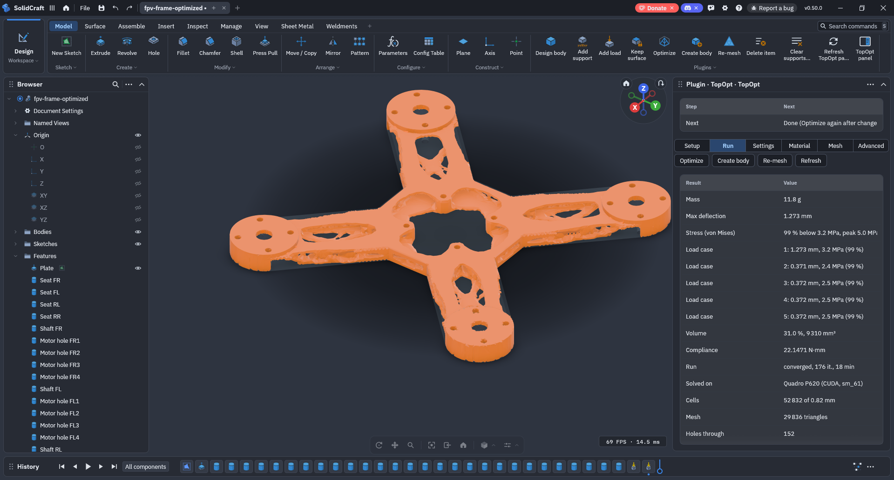

# Example: a lighter 3-inch FPV frame in PETG

A printed frame for a small FPV drone, made lighter with the TopOpt plugin in SolidCraft. We start from a solid blank, say where the frame is held and what pushes on it in flight, and let the optimizer keep 30 % of the material where it carries the most. The result is **69 % lighter** (38.2 g → 11.8 g), and still well within what PETG can take.



## 1. The blank

[`build_frame.py`](build_frame.py) builds the design body with `solidcraft-cli` ([`frame.json`](frame.json) is the command script, [`frame.sc`](frame.sc) the design):

| | |
|---|---|
| Wheelbase (motor to motor, diagonally) | 120 mm, for 3-inch (76 mm) propellers |
| Plate | 5 mm thick: a 46 mm square core and 22 mm wide arms with round ends |
| Motor seats | 22 mm discs, 1.5 mm proud of the arms; M2 holes on a 12 × 12 mm square (1404-size motors) and a 5.5 mm shaft relief |
| Flight stack | M2 holes on a 20 × 20 mm square |
| Volume, mass | 30 081 mm³; 38.2 g in PETG (1.27 g/cm³) |



## 2. The loads

The optimizer makes the frame as stiff as it can under the loads it is given, so the loads decide the shape. They come from what the frame does in flight.

**Case 1, full throttle.** A 1404 motor with a 3-inch propeller on a 4S battery gives about 420 g of static thrust (manufacturers' charts give 380–450 g): 4.12 N per motor, 16.5 N in all. That is 6–7 times the weight of a 250 g drone. The battery and the flight stack sit in the middle of the frame. When the motors punch out, their inertia is what holds the frame back, so the frame is **held at the stack holes** and each motor seat is **pushed up with 4.12 N**.

**Cases 2–5, a side hit on one arm.** 10 N on the end of one arm, in the frame's plane and square to the arm, about four times the drone's weight: clipping a gate or a branch at low speed. There is one case per arm, so the frame comes out the same on all four. A real crash is much harder, hundreds of newtons for a few milliseconds. No light frame is designed to survive that stiff, and a printed frame's arms are spares.

The load cases are separate situations: the optimizer makes the frame stiff in each one, not under all of them at once.

**Material: PETG** (the plugin's preset: E = 2100 MPa, ν = 0.38, 1.27 g/cm³). PETG's tensile strength is about 50 MPa; across printed layers it is about half that. For the check below we allow **20 MPa**.

## 3. The study in SolidCraft

| Panel | Setting |
|---|---|
| Design body | `Frame`, PETG, keep **30 %**, elements 0.8 mm (the budget of 200 000 raises them to 0.82 mm: 52 832 in the body), thinnest member 2 mm (four perimeters of a 0.45 mm nozzle) |
| Support | The four stack holes, held in X, Y and Z |
| Load, case 1 | The four motor seats, 16.48 N up (Fz), spread evenly: 4.12 N each |
| Loads, cases 2–5 | The round end of each arm, 10 N square to the arm |
| Keep surface | The four motor seats: the motors sit on them, so they stay exactly as drawn |



The motor seats and the stack holes get solid pads 1.5 elements deep; the rest is free. Kept surfaces are the body's own CAD triangles in the result ([plugin guide](../../docs/plugin.md#optional-faces-that-must-not-change--keep-surface)).

[`run_study.py`](run_study.py) clicks this through headless with `solidcraft-cli`. With `--solver` the run goes to TopOpt CUDA Solver, as it does in the app when the solver is running.

## 4. The result



The arms became open trusses: two flanges along the arm's edges, which carry the bending from the thrust, and X braces between them, which carry the side hits. The core opened up around the stack, where the battery and the electronics hold the frame anyway. The motor seats stayed solid discs with their holes.

| | Blank | Optimized |
|---|---|---|
| Mass | 38.2 g | **11.8 g** (−69 %) |
| Volume | 30 081 mm³ | 9 316 mm³ (31 % of the blank) |
| Full throttle: largest deflection | 0.42 mm | 1.27 mm |
| Full throttle: von Mises stress, 99 % of the material below / peak | 1.4 / 3.0 MPa | 3.2 / 5.0 MPa |
| Side hit: largest deflection | 0.08 mm | 0.37 mm |
| Side hit: von Mises stress, 99 % below / peak | 0.8 / 1.5 MPa | 2.5 / 4.5 MPa |
| Safety factor against 20 MPa (99 % / peak) | | **6.3 / 4.0** |

The frame is 3.2 times lighter and 3 times more flexible: stiffness per gram is about what the blank had, and the 1.27 mm the motors move at full throttle is on a 60 mm arm. The stress stays below 5 MPa everywhere, a quarter of what we allowed.

<p align="center"></p>

The **Run** tab of the panel shows them after the run:



**How the numbers were checked.** After the optimization the result is made solid where its density reaches the surface threshold and empty elsewhere, and analysed once more under each load case ([`Optimizer::check`](../../docs/topopt-core.md#the-optimizer)). It gives the largest displacement and the von Mises stress of every element. The blank's numbers come from the same analysis of the whole body ([`check_job`](../../crates/topopt-study/examples/check_job.rs)). The analysis agrees with beam theory on a solid cantilever: deflection within 1.5 %, bending stress within 0.4 % ([`tests/stress.rs`](../../crates/topopt-core/tests/stress.rs)). On voxels the single highest stress is exaggerated at the supports and at stair-stepped corners, so compare the 99th percentile with the material's strength.

**The run.** 176 iterations to convergence in 18 minutes on an NVIDIA Quadro P620 (TopOpt CUDA Solver; 52 832 elements, 5 load cases). All four motor seats came out as the CAD model's own triangles: sampled 3 000 times, no point of them is off the CAD faces (0.0000 mm).

## Reproduce it

```sh
python build_frame.py                                   # frame.sc, the blank
# TopOpt CUDA Solver (or TopOpt Solver) watching WORKDIR/results, then:
python -I run_study.py ../../build/topopt.zip WORKDIR --solver
```

`WORKDIR` gets `study.sc` (set up and optimized), `optimized.sc` (with the result as a solid body) and `result.json` (the run's summary, as in [`result.json`](result.json) here). Without `--solver` the plugin optimizes by itself, on one thread, and a plugin job may run for 10 minutes: at this size it would stop long before converging, so run a solver. In the app, open `frame.sc` and do the same in the TopOpt panel.
